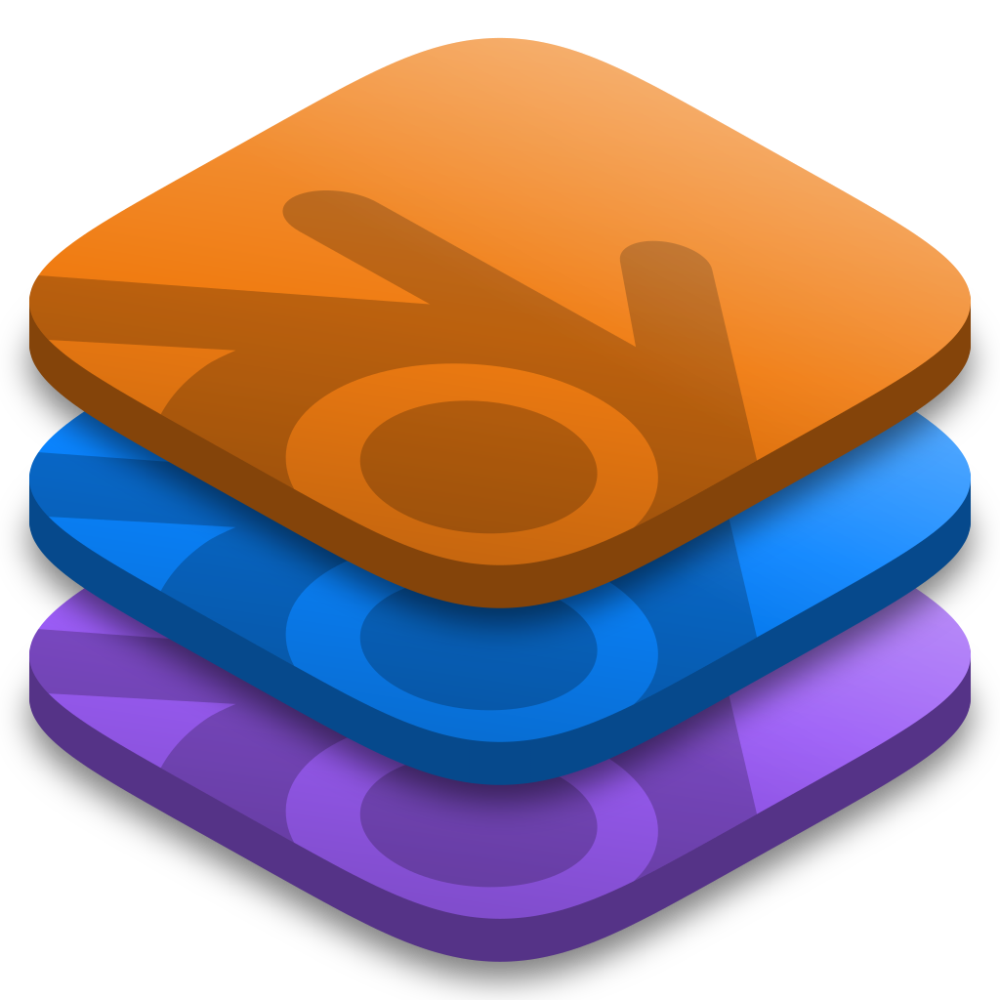

<p align="center">
  
</p>

<h1 align="center">Blend Stack</h1>

<p align="center">
  A fast, minimal launcher for <b>official</b> Blender builds — stable releases, daily builds and experimental pull-request builds, side by side.
</p>

<p align="center">
  <a href="https://github.com/ilumetric/BlendStack/releases">Download</a> ·
  <a href="#features">Features</a> ·
  <a href="#building-from-source">Build from source</a> ·
  <a href="README.ru.md">Русский</a>
</p>

---

## Install

| Platform | Download | |
| --- | --- | --- |
| Windows 10/11 | `BlendStack-<version>-windows-x64.zip` | Unzip anywhere and run `Blend Stack.exe`. No installer, no registry. |
| macOS | `BlendStack-<version>-macos-universal.dmg` | Apple silicon and Intel. The app is not notarized: right-click → Open the first time. |
| Linux | `.AppImage` or `.deb` | |

Get them from [Releases](https://github.com/ilumetric/BlendStack/releases). On Windows, Blend Stack updates itself from Settings → About.

## Features

- **One-click installs** of any official Blender version — downloads are resumable, verified against the official SHA-256 checksums and unpacked in parallel.
- **Three channels**, all straight from Blender's own servers:
  - **Stable** — every release from [download.blender.org](https://download.blender.org/release/), LTS marked.
  - **Daily** — alpha, beta and release-candidate builds from [builder.blender.org](https://builder.blender.org/download/daily/).
  - **Experimental** — builds of open pull requests, linked to their PR page.
- **Library** — launch any installed version, set a default, favorites, custom names and per-build launch arguments, import an existing Blender installation.
- **Updates in place** — daily and experimental builds show an *Update* button when a newer build of the same line appears; the old build is replaced and its settings carried over.
- **Recent files** — merged from every Blender version's history, with the thumbnails embedded in the `.blend` files. Each file opens in the Blender version that saved it.
- **Drag & drop** `.blend` files onto the window to pick which Blender opens them.
- **Double-click any `.blend`** (Windows, opt-in) — Blend Stack opens it in the Blender version that saved it, without showing its window; it asks only when that version isn't installed.
- **Taskbar icon that survives updates** — when a build is updated or removed, the taskbar shortcuts Windows keeps for Blender are pointed at an installed build of the same series, so Blender's button never turns blank.
- **Notifications** — a background check (configurable interval) for new releases, new daily versions and updates to builds you have installed, delivered as native notifications and in the in-app notification center.
- **News** — the latest posts from blender.org and the Blender Developers Blog.
- **System tray** quick-launch menu, start at login, close-to-tray.
- **Native feel** — translucent Mica window on Windows 11 / vibrancy on macOS, light and dark themes, English and Russian UI.
- **Self-contained on Windows** — one executable with everything built in; settings, cache, logs and Blender builds live in its folder.

Blend Stack only ever downloads builds published by the Blender Foundation.

## Tech stack

| Layer | Choice |
| --- | --- |
| App shell | [Tauri 2](https://tauri.app) — small native binary using the system WebView |
| Backend | Rust (`reqwest`, `tokio`, `zip`) — downloads, extraction, scanning, notifications |
| UI | React 19 + TypeScript + Vite, [Zustand](https://github.com/pmndrs/zustand) for state, [Lucide](https://lucide.dev) icons |

## Building from source

Prerequisites:

- [Rust](https://rustup.rs) (stable, 1.85+)
- [Node.js](https://nodejs.org) 20+
- Platform dependencies for Tauri — see [Tauri prerequisites](https://v2.tauri.app/start/prerequisites/) (on Windows: Microsoft C++ Build Tools and WebView2, which ships with Windows 11).

```bash
npm install
npm run app:dev      # run with hot reload
npm run app:build    # release build: src-tauri/target/release (exe), bundle/ (dmg, AppImage, deb)
```

Run the checks the CI runs:

```bash
npm run typecheck
cargo test --manifest-path src-tauri/Cargo.toml
```

## Project layout

```
src/                  React UI
  views/              Library, Builds, News, Settings, popovers
  components/         Reusable UI pieces (segmented control, menus, dialogs…)
  i18n/               English and Russian strings
  lib/                API bindings, types, build helpers, formatting
src-tauri/src/        Rust backend
  sources/            Official build feeds (stable, daily, experimental) and news
  download.rs         Download → verify → extract pipeline
  library.rs          Installed builds on disk
  watcher.rs          Background check for new builds
  recent.rs           Recent files and .blend thumbnails
```

## Where things are stored

When the app's folder is writable (the Windows zip, a plain Linux binary), everything stays in it:

```
Blend Stack/
├─ Blend Stack.exe
├─ data/        settings, cache, logs, WebView profile
└─ Builds/      stable/ daily/ experimental/
```

Copy or move the folder and nothing is left behind. The only things written elsewhere are the optional *Open at login* entry and, when you turn it on, the `.blend` file type in the registry. On macOS (app bundle) and for AppImages the standard per-user folders are used (`~/Library/Application Support/io.github.ilumetric.blendstack`, `~/.local/share/io.github.ilumetric.blendstack`).

The builds folder can be changed in Settings — installed builds move along with it. It uses the same `stable` / `daily` / `experimental` layout as Blender Launcher, so an existing Blender Launcher library can be opened directly. Your Blender preferences and add-ons are untouched: every build uses Blender's normal configuration folder.

> On Windows avoid keeping builds under `AppData`: some security policies stop Blender's bundled runtime (`blender.crt`) from loading there, which shows up as a "side-by-side configuration" error.

## Releasing

Releases are built and published by GitHub Actions:

1. **Actions → Release → Run workflow**, choose `patch`, `minor` or `major`.
2. The workflow bumps the version everywhere (`scripts/version.mjs`), commits, tags `vX.Y.Z`, builds Windows, macOS and Linux in parallel and publishes the release with generated notes and `SHA256SUMS.txt`.

Pushing a `vX.Y.Z` tag yourself works too, as long as the files carry that version (`npm run release:version -- X.Y.Z`). Every push to `main` also leaves a ready-to-run Windows build under the CI run's artifacts.

## Contributing

Issues and pull requests are welcome — see [CONTRIBUTING.md](CONTRIBUTING.md).

## License

[MIT](LICENSE) © Max Derksen

Blend Stack is an independent project and is not affiliated with or endorsed by the Blender Foundation. Blender and the Blender logo are trademarks of the Blender Foundation; the logo is used to mark Blender builds.
